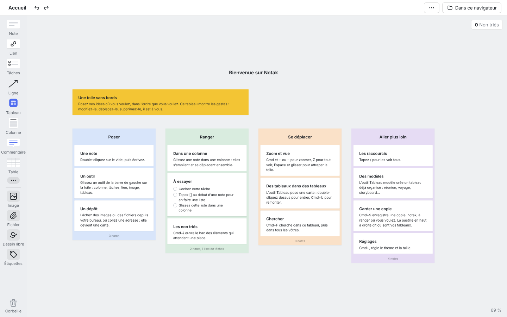

# Notak

**Des tableaux visuels libres : notes, images, liens, colonnes, flèches, tâches, croquis, sur une toile sans bords.**
Une alternative open source à Milanote, en TypeScript et React. *[Read in English](README.md)*



## L'essayer

**[notak.app](https://notak.app)** tourne entièrement dans votre navigateur : pas de compte, pas de serveur, rien ne
quitte votre appareil. Vos tableaux vivent dans le navigateur ; **Cmd+S** en garde une copie `.notak` où vous voulez
(votre disque, iCloud Drive, une clé USB), **Cmd+O** en rouvre une. Sur Chrome et Edge pour ordinateur, on peut
aussi synchroniser un dossier de son nuage (expérimental).

Pour travailler à plusieurs en temps réel (comptes, partage, curseurs en direct), installez votre propre Notak : il
est libre et tient dans un conteneur (voir [Héberger](#héberger)).

## Deux éditions, un seul code

| | **Locale** (notak.app) | **Serveur** (auto-hébergée) |
|---|---|---|
| Où vivent les tableaux | dans le navigateur (IndexedDB), et dans des copies `.notak` | sur votre serveur (SQLite), gardés hors ligne dans le navigateur |
| Comptes | aucun | oui |
| À plusieurs | on s'échange des `.notak`, ou un dossier partagé synchronisé | en direct : présence, curseurs, commentaires, partage par adresse ou par lien |
| Aperçus de liens | l'adresse seule (un navigateur ne peut pas lire les autres sites) | titre, image, lecteur |
| Tourne sur | n'importe quel hébergement statique | un conteneur Docker |

Les deux se construisent depuis `apps/web` ; `VITE_EDITION=locale` choisit l'édition locale à la construction, et
aucun des deux paquets ne contient le code de l'autre.

Notak couvre presque toutes les fonctionnalités de Milanote : voir [`docs/FONCTIONNALITES.md`](docs/FONCTIONNALITES.md).

## Développer

Il faut [Bun](https://bun.sh) 1.3 et Node 22.13 ou plus récent.

```bash
bun install
bun run dev:locale          # l'édition locale, sur http://localhost:5173
```

L'édition serveur a aussi besoin de son serveur :

```bash
bun run serveur             # terminal 1 : API, comptes et synchro en direct sur :3005
bun run dev                 # terminal 2 : l'application, relayée vers le serveur
```

Vérifications : `bun run typecheck` et `bun run test` (environ 1 500 essais, dont quelques centaines de scénarios
de synchro tirés au hasard). Les contributions sont bienvenues : commencez par [`CONTRIBUTING.md`](CONTRIBUTING.md)
et [`docs/ARCHITECTURE.md`](docs/ARCHITECTURE.md).

| Geste | Effet |
|---|---|
| Double-clic sur le vide | nouvelle note |
| Double-clic sur une note, ou Entrée | écrire dedans ; Échap pour sortir |
| Glisser une note | la déplacer (Maj : sur un seul axe) |
| Glisser sur le vide | lasso (Maj ou Cmd : inverse) |
| Molette, espace + glisser, bouton du milieu | défiler |
| Cmd + molette, pincement | zoomer |
| Z | tout voir ; encore Z : 100 % |
| Cmd+Z / Cmd+Maj+Z | annuler, rétablir |
| / | tous les raccourcis |

## Héberger

### L'édition serveur (comptes, travail à plusieurs en direct)

Un seul conteneur sert l'application, les comptes et le travail à plusieurs, sur le port 3005. Les données (base
SQLite et fichiers envoyés) vivent dans le volume `/donnees`.

```bash
git clone https://github.com/Anonym0os/notak
cd notak
docker build -t notak .
docker run -d -p 3005:3005 -v notak-donnees:/donnees notak
```

L'image suppose un relais HTTPS devant elle (cookie `Secure`, adresse du client lue dans `X-Forwarded-For`).
Pour l'essayer en HTTP sur sa machine : `-e NOTAK_COOKIE_SECURISE=0 -e NOTAK_RELAIS=0`.

### L'édition locale (comme notak.app)

Des fichiers statiques servis par nginx, sans API :

```bash
docker build -f apps/site/Dockerfile --build-arg VITE_CONTACT=vous@exemple.fr -t notak-site .
docker run -d -p 8080:80 notak-site
```

`VITE_CONTACT` est l'adresse proposée sous « Nous écrire » dans l'application ; sans elle, seul le lien vers ce
dépôt s'affiche. On peut aussi construire les fichiers soi-même (`bun run build:locale`, dans `apps/web/dist`) et
les poser sur n'importe quel hébergement statique, toute adresse inconnue renvoyant vers `index.html`.

## Dépôt

| Dossier | Rôle |
|---|---|
| `packages/tableau` | `@notak/tableau` : le cœur (caméra, sélection, historique, magasin Yjs), la toile React, les types d'éléments, le moteur de synchro par dossier |
| `apps/web` | l'application web, les deux éditions |
| `apps/serveur` | le serveur de l'édition serveur (Hono, Hocuspocus, SQLite) |
| `apps/site` | notak.app : l'édition locale derrière nginx, et la page « À propos » |
| `apps/bureau` | la coque de bureau (Tauri) |
| `docs/SPEC.md` | ce que Notak doit faire, geste par geste |
| `docs/FONCTIONNALITES.md` | chaque fonctionnalité de Milanote, et où en est Notak |
| `docs/ARCHITECTURE.md` | comment le code est rangé |
| `docs/PUBLIER.md` | le modèle de notak.app : gratuit, local, honnête |
| `docs/STOCKAGE.md` | le format du dossier synchronisé, et ce qui le prouve |

## Licence

AGPL-3.0. Qui héberge une version modifiée doit en publier le code.
